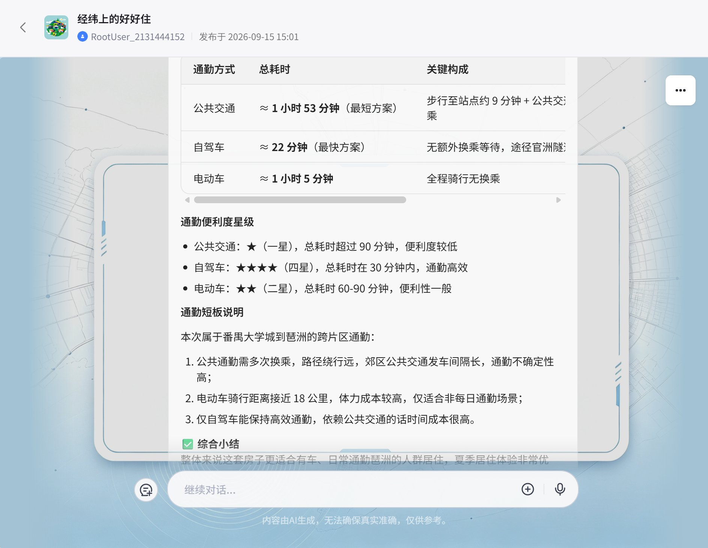
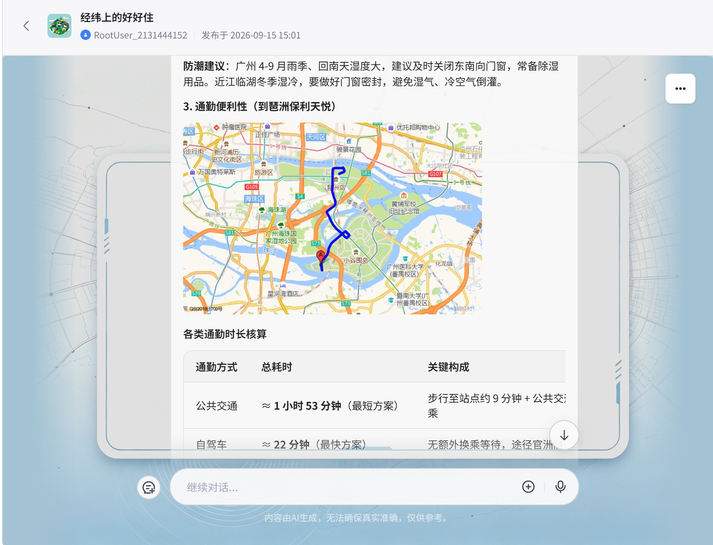
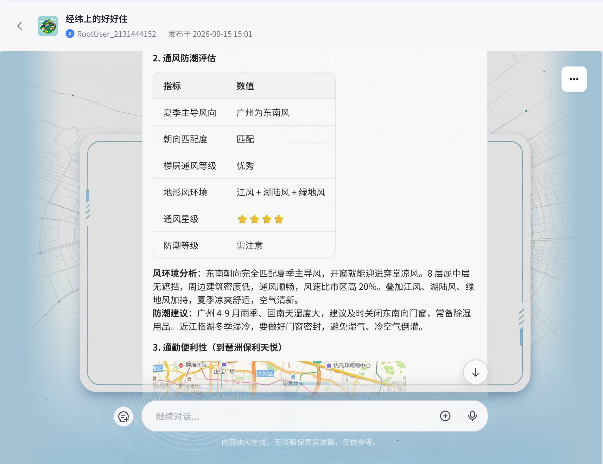
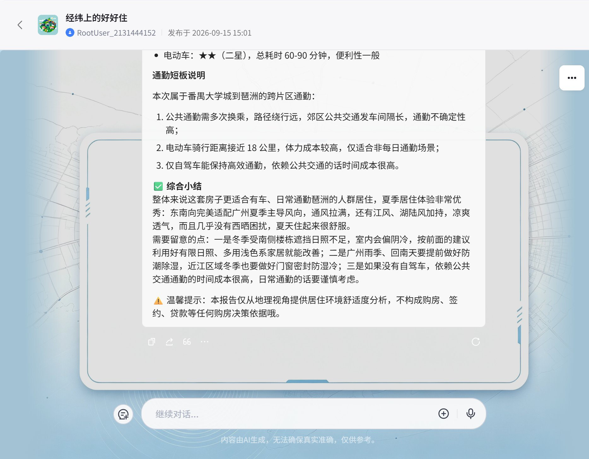

# 经纬上的好好住

> 用地理 + AI，帮在城市打拼的年轻人找到"好好住"的家。

[在线体验](https://www.coze.cn/store/agent/7683097812594475043)

## ✨ 简介

「经纬上的好好住」是一个基于 [Coze（扣子）](https://www.coze.cn)搭建的选房顾问智能体。提供几套备选房源后，它会从三大居住维度做量化分析——

- ☀️ **日照采光**：地址转真实经纬度，代入太阳高度角公式，计算冬至/夏至日照时长、遮挡比例、采光星级、西晒评分
- 🌬️ **通风防潮**：宏观城市气候（主导风向、湿度、雨季）× 微观地形风环境（峡管效应、湖陆风、热岛环流等九类）双层分析
- 🚇 **通勤效率**：高德五模式路线规划（公交/步行/骑行/电动车/驾车），自动生成通勤路线静态地图

最终输出"哪一套住得最舒服"的综合建议——有数据、有画面、有温度。

**技术栈**：Coze 低代码平台 · 豆包 2.0 pro · 高德地图开放平台 · 知识库检索增强

## 🌟 项目亮点

- **真计算，不是 AI 编的**：日照分析用天文公式 `h = 90° − |φ − δ|` 实算冬至/夏至太阳高度角，遮挡判定用三角投影关系，结论可追溯
- **并行扇出架构**：三大维度子工作流同时执行，大模型只负责"把数字讲成人话"，机器算数据、LLM 写报告，各司其职
- **知识库抑制幻觉**：城市气候与地形风分类体系走知识库检索，LLM 输出强制 JSON、判断必须带依据
- **可解释的评级体系**：采光星级、通风星级、西晒分、防潮等级，每个结论背后都是显式规则表
- **配套 3D 日照光影模拟器**：报告内嵌 [在线模拟器](https://superlative-fox-6658a8.netlify.app)，拖动时间条即可直观查看一天中日照的变化
- **安全降级设计**：路线点抽稀防 URL 超长、地图 API 失败自动降级直线、入参全部带默认值

## 🚀 快速开始

### 在线使用

直接访问「在线体验」链接，在 Coze 商店中与智能体对话。

提供房源信息即可开始测评：城市、房源地址、楼层、朝向、楼间距、南侧楼高、通勤目的地。

### 复刻到自己的 Coze 工作区

本仓库收录了完整的搭建档案，可 1:1 复刻：

1. 按 [`agent-config.md`](agent-config.md) 配置模型与参数
2. 将 [`prompts/system-prompt.md`](prompts/system-prompt.md) 填入「人设与回复逻辑」，[`prompts/opening-greeting.md`](prompts/opening-greeting.md) 填入「开场白」
3. 按 `workflows/` 下的流程文档搭建主工作流与三个子工作流（含核心代码源码与各节点提示词）
4. 申请[高德开放平台](https://lbs.amap.com/) Key 并配置地图插件

## 🖼️ 效果演示

以广州一处房源（大学城 → 琶洲通勤）为例的真实测评输出：

**1. 日照采光分析** — 冬至日照 1.5h、遮挡比 1.4 判定冬季遮挡，并附可交互的 3D 日照模拟器


**2. 通风防潮评估** — 识别出「江风 + 湖陆风 + 绿地风」三重地形风叠加，通风 4 星、防潮需注意



**3. 通勤便利性** — 五模式对比（公交 1h53m / 自驾 22m / 电动车 1h5m），路线图 + 星级 + 短板说明





**综合小结** — 三大维度融合成最终居住建议 + 免责提示



## 📁 目录结构

```
.
├── README.md                  # 本说明文件
├── agent-config.md            # 模型与运行参数配置档案 + 复刻步骤
├── prompts/                   # 智能体级提示词
│   ├── system-prompt.md       #   人设与回复逻辑
│   └── opening-greeting.md    #   开场白
└── workflows/                 # 工作流档案
    ├── main-flow.md           #   主流程（并行扇出 → LLM 汇总）
    ├── workflow-sunshine.md   #   日照采光分析
    ├── workflow-wind.md       #   通风防潮分析
    ├── workflow-commute.md    #   通勤效率分析
    ├── code/                  #   代码节点源码（sunshine-calc.js / commute-map.js）
    ├── prompts/               #   各 LLM 节点提示词
    └── *.png                  #   工作流画布与节点截图
```

## 🛠️ 使用的技术

- [Coze（扣子）](https://www.coze.cn) — 低代码智能体搭建平台
- [高德开放平台](https://lbs.amap.com/) — 地理编码、路线规划、静态地图
- 豆包 2.0 pro — 大语言模型

## ⚠️ 免责声明

本智能体的分析仅从地理与居住环境舒适度视角出发，**不构成购房、签约、贷款等任何购房决策依据**，不做房价涨跌预测，不提供投资建议。最终决定权永远在用户自己手中。

## 📄 License

[MIT](LICENSE)

---

⭐ 如果这个项目对你有帮助，欢迎点个 Star！
