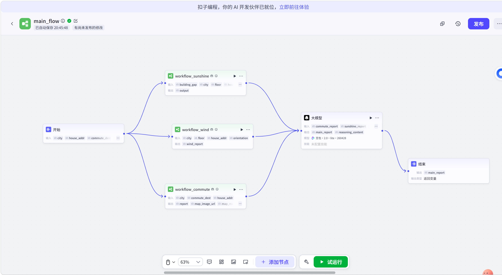
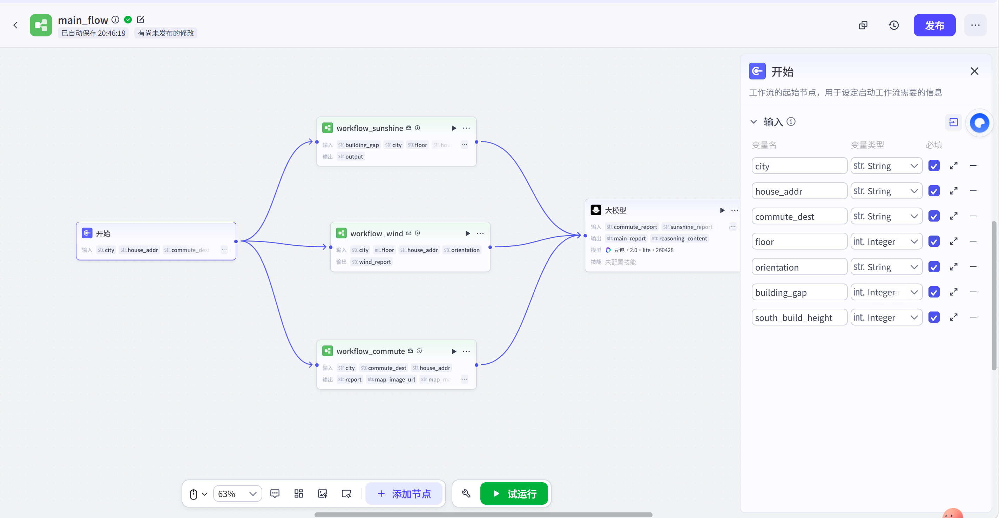
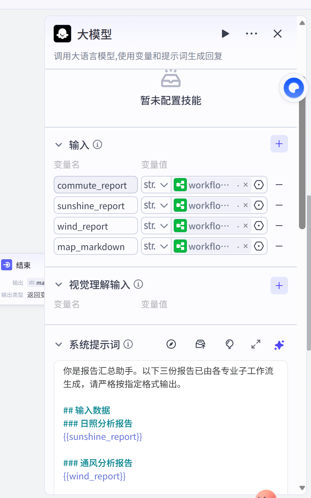

# main_flow — 主工作流说明

> 「经纬上的好好住」的主工作流，负责汇总三大维度的居住环境分析。
> 本目录的截图存档自 2026-09-15 发布版。



## 流程结构

```
开始（7 项参数）
   ├─→ workflow_sunshine   （日照采光分析）──→ output ─────────┐
   ├─→ workflow_wind       （通风防潮分析）──→ wind_report ────┼─→ 大模型（报告汇总）─→ 结束
   └─→ workflow_commute    （通勤效率分析）──→ report          │      ↑
           └────────────────────────→ map_image_url ───→ map_markdown（视觉理解输入）
```

**设计模式**：并行扇出（fan-out）→ 大模型扇入（fan-in）汇总。
三个子工作流相互独立、同时执行，互不等待，最后由大模型节点把三份专业报告合成为一份最终建议。

## 开始节点 — 输入参数

| 变量名 | 类型 | 含义 |
|---|---|---|
| city | String | 城市名（不带"市"） |
| house_addr | String | 房源地址 |
| commute_dest | String | 通勤目的地 |
| floor | Integer | 楼层 |
| orientation | String | 朝向 |
| building_gap | Integer | 楼间距（米） |
| south_build_height | Integer | 南侧楼高（米） |



## 三个子工作流

| 子工作流 | 职责 | 主要输入 | 输出 |
|---|---|---|---|
| `workflow_sunshine` | 日照采光评级（结合楼层、楼间距、南侧楼高计算遮挡与日照时长） | building_gap、city、floor | output |
| `workflow_wind` | 通风防潮风险分析（结合城市气候特征） | city、floor、house_addr、orientation | wind_report |
| `workflow_commute` | 通勤效率评估（调用高德地图） | city、commute_dest、house_addr | report、map_image_url |

## 大模型节点 — 报告汇总

- 模型：豆包 2.0 pro
- 输入：`commute_report`、`sunshine_report`、`wind_report`、`map_markdown`
- 系统提示词（节选）：

```text
你是报告汇总助手。以下三份报告已由各专业子工作流生成，请严格按指定格式输出。

## 输入数据
### 日照分析报告
{{sunshine_report}}

### 通风分析报告
{{wind_report}}
...
```

- 亮点：大模型节点同时接收 `map_image_url` 的视觉理解输入，可将通勤地图一并纳入最终报告。



## 结束节点

- 输出变量：`main_report`（返回变量），即最终给用户的综合居住环境测评报告。

## 设计要点

1. **并行执行**：三大维度同时分析，缩短用户等待时间
2. **单一职责**：每个子工作流只管一个维度，方便单独迭代优化
3. **机器算数据，大模型写报告**：数值计算交给确定性逻辑，语言组织交给 LLM，各司其职
4. **图文结合**：通勤分析输出地图图片，经视觉理解融入最终报告，建议更直观
