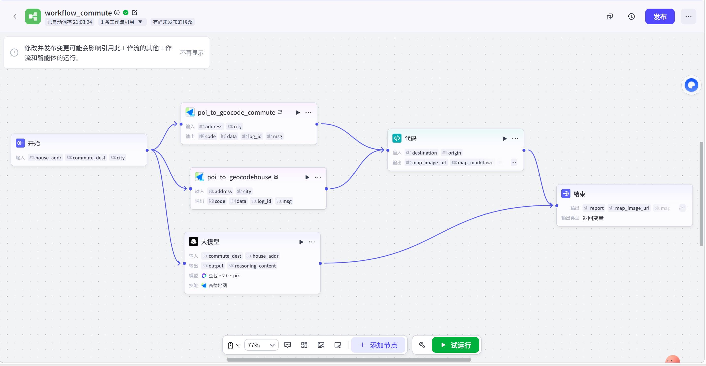
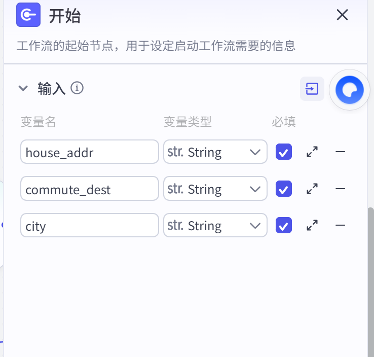
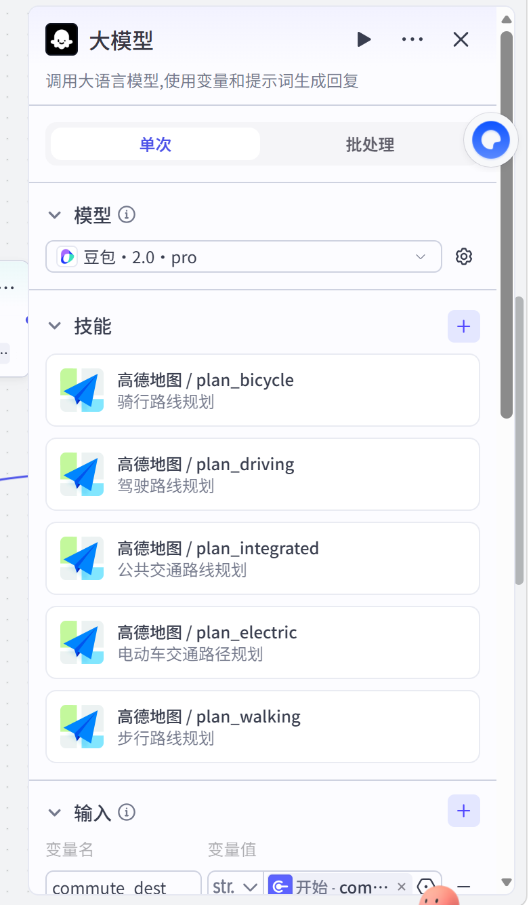
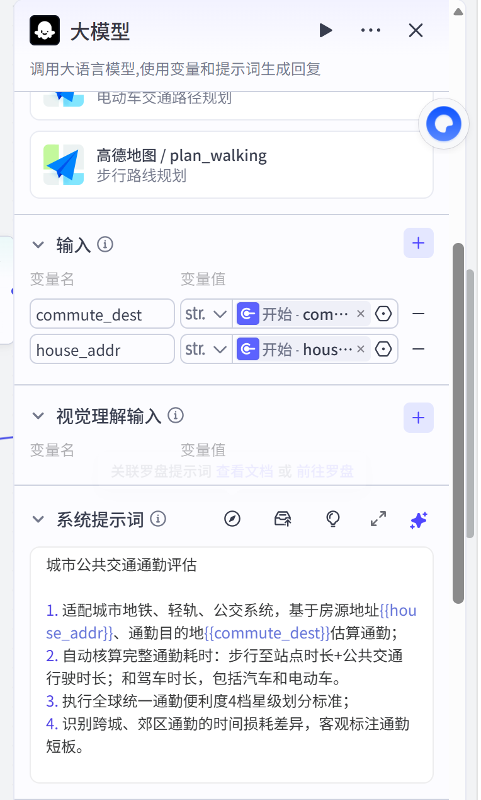
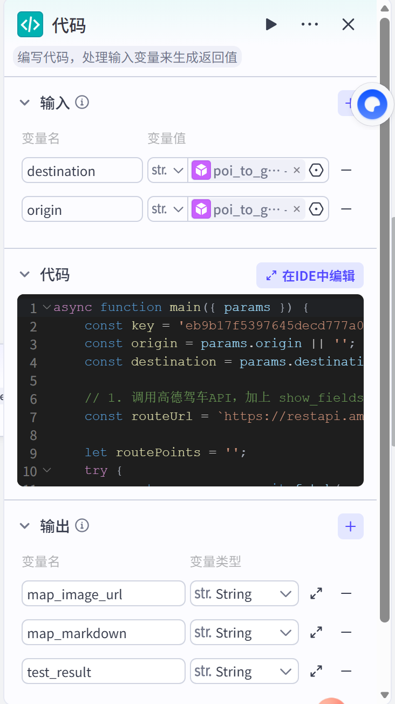

# workflow_commute — 通勤效率分析子工作流

> 「经纬上的好好住」三大维度之三：高德多模式路线规划 + 静态路线图生成，评估通勤效率。



## 流程结构

```
开始（house_addr、commute_dest、city）
   ├─→ poi_to_geocode_commute（通勤目的地 → 经纬度）─→ destination ─┐
   ├─→ poi_to_geocodehouse（房源地址 → 经纬度）──────→ origin ───────┼─→ 代码（生成通勤路线静态地图）─→ map_image_url / map_markdown ─→ 结束
   └─→ 大模型（挂 5 个高德插件做多模式路线规划）──────→ report ───────┘
```

**三路并行**：两个地理编码节点为地图代码节点供坐标；大模型节点独立做多模式通勤评估，最终同时输出文字报告 + 路线图。

## 开始节点 — 输入参数

| 变量名 | 类型 | 必填 | 含义 |
|---|---|---|---|
| house_addr | String | ✅ | 房源地址 |
| commute_dest | String | ✅ | 通勤目的地 |
| city | String | ✅ | 城市名 |



## 节点详解

### ① 双地理编码节点

`poi_to_geocode_commute`（通勤目的地）与 `poi_to_geocodehouse`（房源地址）各自把地址转成高德经纬度，分别为代码节点提供 `destination` 和 `origin`。

### ② 大模型节点 — 多模式通勤评估

挂载了 **5 个高德地图插件**，把出行方式全覆盖：

| 插件 | 覆盖方式 |
|---|---|
| plan_integrated | 公共交通（地铁/轻轨/公交） |
| plan_walking | 步行 |
| plan_bicycle | 骑行 |
| plan_electric | 电动车 |
| plan_driving | 驾车 |

系统提示词（截图）：

```text
城市公共交通通勤评估

1. 适配城市地铁、轻轨、公交系统，基于房源地址{{house_addr}}、
   通勤目的地{{commute_dest}}估算通勤；
2. 自动核算完整通勤耗时：步行至站点时长+公共交通行驶时长；
   和驾车时长，包括汽车和电动车。
3. 执行全球统一通勤便利度4档星级划分标准；
4. 识别跨城、郊区通勤的时间损耗差异，客观标注通勤短板。
```

输出 `report`：多模式通勤对比评估报告。




### ③ 代码节点 — 通勤路线静态地图

📄 完整源码：[`code/commute-map.js`](code/commute-map.js)（开源版本已将高德 Key 替换为 `YOUR_AMAP_KEY` 占位符）

工作流程：

1. 调用高德**驾车路线 API**（`show_fields=polyline`）拿到完整路线的坐标串
2. **抽稀优化**：坐标点超过 3500 字符时每 3 个取 1 个（并确保终点保留），防止静态地图 URL 超长
3. **失败降级**：拿不到路线时退化为起终点直线，保证节点永不空返回
4. 拼接高德**静态地图 API** URL：蓝色路线 + 红色 A 标记（房源）+ 绿色 B 标记（目的地）

输出：
- `map_image_url` — 静态地图链接（供结束节点返回）
- `map_markdown` — Markdown 图片语法（供主流程大模型节点嵌入报告）



## 设计亮点

1. **多模式对比**：不只说"通勤 40 分钟"，而是公交/驾车/骑行/电动车/步行五种方式横向对比，还能算"步行至站点 + 公共交通行驶"的门到门总耗时
2. **文字 + 图像双输出**：报告有数据，路线图有画面，主流程还能通过视觉理解把图融进最终建议
3. **健壮性设计**：URL 抽稀 + 直线降级，真实世界的 API 总会出错，代码里提前想好了退路
4. **客观标注短板**：提示词明确要求"识别跨城、郊区通勤的时间损耗差异，客观标注通勤短板"——不报喜不报忧
