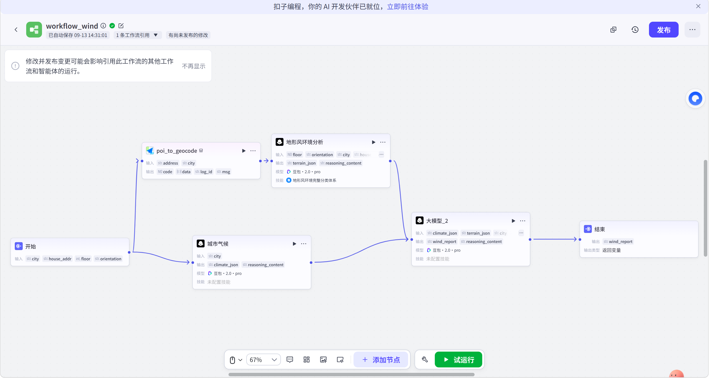
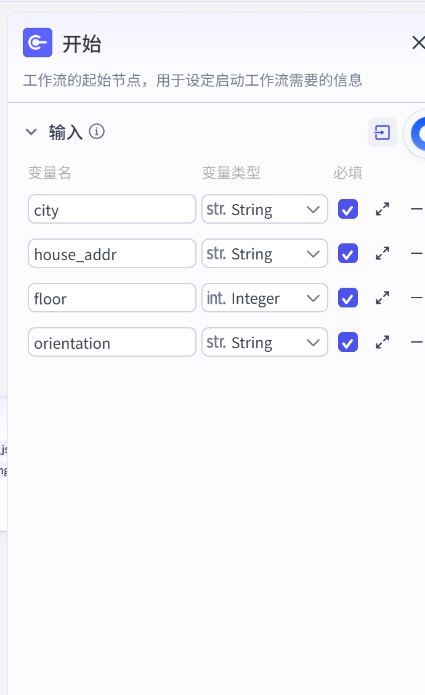
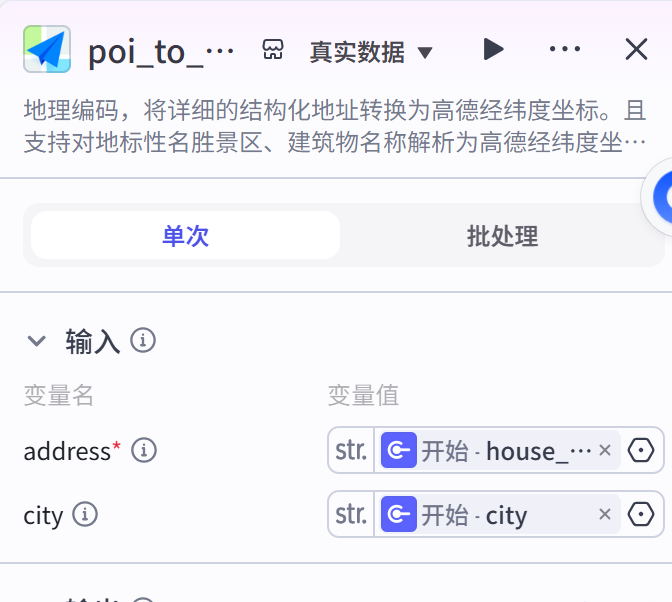
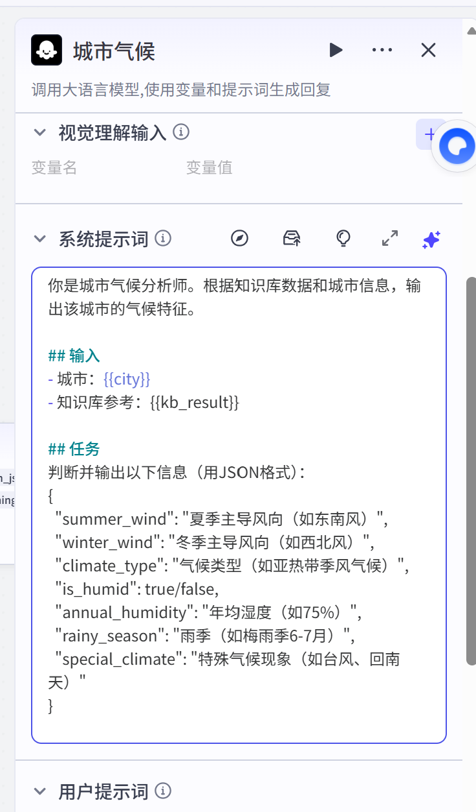
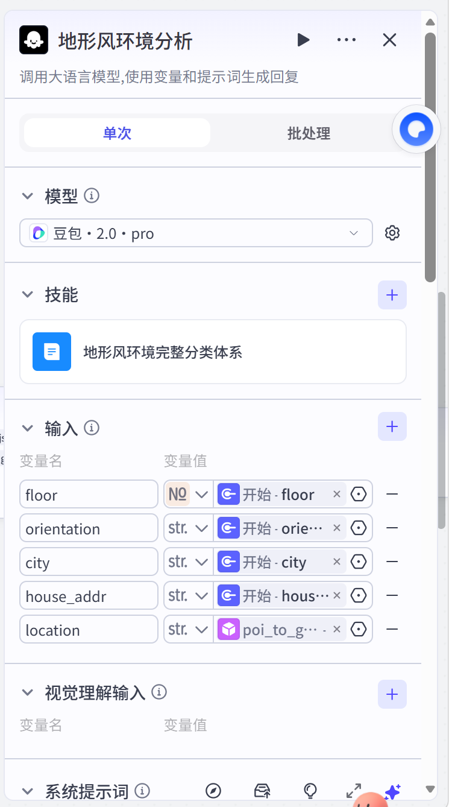
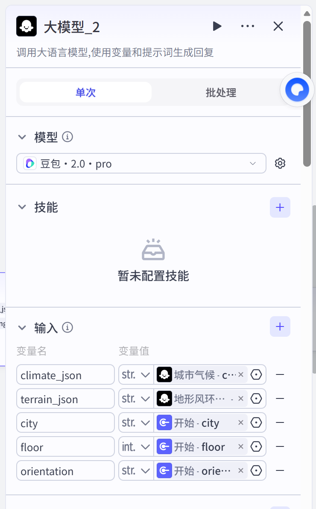

# workflow_wind — 通风防潮分析子工作流

> 「经纬上的好好住」三大维度之二：城市气候 + 地形风环境双路分析，评估通风防潮风险。



## 流程结构

```
开始（city、house_addr、floor、orientation）
   ├─→ poi_to_geocode（高德地理编码）→ location ─→ 地形风环境分析（LLM + 知识库）─→ terrain_json ─┐
   └─→ 城市气候（LLM + 知识库）──────────────────────────────────────────→ climate_json ────┼─→ 大模型_2（汇总生成 wind_report）→ 结束
```

**两路并行**：
- **气候路线**（宏观）：城市气候节点 → 判断这座城市的气候类型、主导风向、湿度、雨季
- **地形路线**（微观）：地理编码拿经纬度 → 地形风环境分析节点 → 判断这个具体位置受哪些局地风影响

## 开始节点 — 输入参数

| 变量名 | 类型 | 必填 | 含义 |
|---|---|---|---|
| city | String | ✅ | 城市名 |
| house_addr | String | ✅ | 房源地址 |
| floor | Integer | ✅ | 楼层 |
| orientation | String | ✅ | 朝向 |



## 节点详解

### ① poi_to_geocode（高德地理编码插件）

与日照工作流共用同一插件：`address ← house_addr`、`city`，输出经纬度坐标。



### ② 城市气候（LLM 节点 · 宏观气候）

系统提示词（截图）：

```text
你是城市气候分析师。根据知识库数据和城市信息，输出该城市的气候特征。

## 输入
- 城市：{{city}}
- 知识库参考：{{kb_result}}

## 任务
判断并输出以下信息（用JSON格式）：
{
  "summer_wind": "夏季主导风向（如东南风）",
  "winter_wind": "冬季主导风向（如西北风）",
  "climate_type": "气候类型（如亚热带季风气候）",
  "is_humid": true/false,
  "annual_humidity": "年均湿度（如75%）",
  "rainy_season": "雨季（如梅雨季6-7月）",
  "special_climate": "特殊气候现象（如台风、回南天）"
}
```

输出 `climate_json`：城市级气候画像（主导风向、湿度、雨季、台风/回南天等特殊现象）。



### ③ 地形风环境分析（LLM 节点 · 微观局地风）

- 挂载知识库「地形风环境完整分类体系」
- 输入：floor、orientation、city、house_addr、location（经纬度）
- 九类地形风分类（城市/水域/山地/绿地四大类），判定可多选且必须带依据
- 强制输出 JSON（terrains 数组 + primary_terrain + wind_speed_impact）

📄 完整提示词：[`prompts/wind-terrain-prompt.md`](prompts/wind-terrain-prompt.md)



### ④ 大模型_2（汇总节点）

- 输入：`climate_json`（城市气候）、`terrain_json`（地形风）、`city`、`floor`、`orientation`
- 把宏观气候 + 微观地形风融合，结合楼层与朝向，生成最终的通风防潮分析报告 `wind_report`



## 设计亮点

1. **宏观 × 微观双层分析**：先问"这座城市风怎么样"，再问"这个位置的地形风特殊在哪"，两层叠加才敢下结论
2. **知识库兜底专业知识**：气候数据和地形风分类体系都走知识库检索，LLM 只负责推理与组织，减少幻觉
3. **结构化中间产物**：两路都强制 JSON 输出，汇总节点拿到的不是散文而是数据
4. **结合楼层与朝向落地**：风环境最终要落到"你这层、这个朝向"的实际居住体验上
